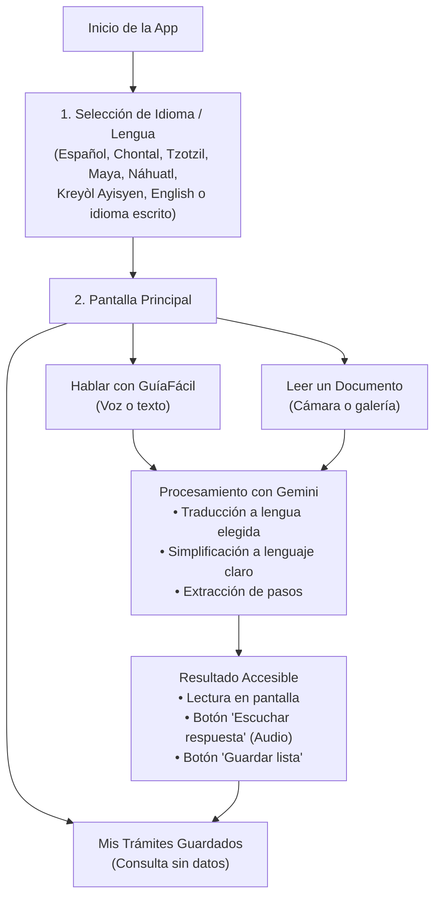

# GuíaFácil — Puentes de Oportunidad

**Equipo:** Coder Killers  
**Integrantes:**
* Carlos Leonardo Mata Silva – Líder de proyecto
* Anahí Falcón Hernández
* Luis Gonzalo Guzman Sanchez  

**Campus:** Villahermosa  
**Reto:** Reto 1 · Puentes de oportunidad (ODS 10)  
**Prototipo / Boceto Interactivo (Figma):** [Ver diseño interactivo en Figma](https://www.figma.com/make/ltcK0BY0zjrp1XmcTp84kz/Gu%C3%ADaF%C3%A1cil-Mobile-Design?t=UxkSrOZwocsLwGYi-1) (No contiene la versión final de la aplicación)

---

## 1. Resumen Ejecutivo

**GuíaFácil** es una aplicación móvil de accesibilidad diseñada para adultos mayores, migrantes y personas en situación de vulnerabilidad que enfrentan barreras lingüísticas, digitales o burocráticas al intentar acceder a servicios de salud, pensiones y apoyos sociales. Mediante inteligencia artificial (Google Gemini), la plataforma traduce trámites complejos a un lenguaje claro y empático, permite interactuar por voz o texto en múltiples idiomas y lenguas originarias, interpreta fotografías de documentos oficiales o recetas médicas y genera listas de verificación paso a paso que el usuario puede guardar para consultar incluso cuando pierde conexión a internet.

---

## 2. Boceto y Concepto

### El Problema
La información sobre trámites gubernamentales, convocatorias, pensiones y servicios de salud suele encontrarse dispersa en portales complejos y redactada en un lenguaje técnico o burocrático. Para adultos mayores, migrantes o habitantes de comunidades con baja conectividad y recursos, esta barrera provoca confusión, errores en sus solicitudes, pérdida de tiempo y dinero en traslados innecesarios y, en última instancia, la exclusión de derechos y apoyos fundamentales.

### Propuesta de Solución
**GuíaFácil** actúa como un acompañante digital accesible con interfaz de alto contraste y navegación lineal sin menús ocultos. Desde el primer ingreso, recibe al usuario en su propio idioma o lengua originaria y le ofrece tres acciones claras: conversar por voz o texto para resolver dudas, fotografiar documentos físicos para recibir una explicación sencilla en texto o audio, y almacenar sus guías personalizadas localmente para consultarlas sin depender de datos móviles constantes.

### Alineación con el Objetivo de Desarrollo Sostenible (ODS 10)
* **ODS 10 (Reducción de las desigualdades):** Promueve la inclusión social, económica y política de todas las personas sin distinción, eliminando la brecha del lenguaje burocrático y la barrera idiomática. Al incorporar español, inglés, criollo haitiano y lenguas indígenas como chontal, tzotzil, maya y náhuatl (además de entrada libre de idioma), garantiza igualdad de oportunidades para que grupos históricamente desatendidos comprendan y ejerzan sus derechos de acceso a salud y programas sociales.

### Mapa de Uso (Flujo de Usuario)

