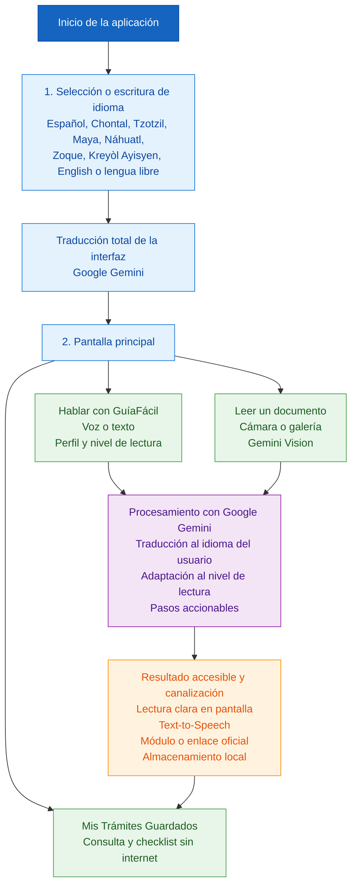

# GuíaFácil — Puentes de Oportunidad

> Inteligencia artificial, accesibilidad digital e inclusión lingüística para reducir las desigualdades.


## Información general

**Equipo:** Coder Killers

**Integrantes:**

- **Carlos Leonardo Mata Silva** — Líder de proyecto.
- Anahí Falcón Hernández.
- Luis Gonzalo Guzmán Sánchez.

**Campus:** Villahermosa.

**Reto:** Reto 1 · Puentes de Oportunidad (ODS 10).

**Prototipo / Boceto interactivo:**

- [Ver diseño interactivo en Figma](https://www.figma.com/make/ltcK0BY0zjrp1XmcTp84kz/Gu%C3%ADaF%C3%A1cil-Mobile-Design?t=UxkSrOZwocsLwGYi-1)

> **Nota:** El diseño de Figma corresponde al boceto inicial de UX. La implementación funcional completa se encuentra en este repositorio Android.

---
## 📲 Descargar Aplicación (Android)

Descarga e instala la última versión de **GuíaFácil** directamente en tu teléfono Android:

[](https://github.com/TU_USUARIO/GuiaFacil/raw/refs/heads/main/GuiaFacil-v1.0.apk)

> **Nota de instalación:** Si tu teléfono te pide permiso para instalar aplicaciones de fuentes desconocidas (desde el navegador o gestor de archivos), selecciona **Configuración > Permitir desde esta fuente** y continúa con la instalación.
> 
## Tabla de contenidos

1. [Resumen ejecutivo](#1-resumen-ejecutivo)
2. [Planteamiento del reto y solución](#2-planteamiento-del-reto-y-solución)
3. [Mapa de uso (Flujo de usuario)](#3-mapa-de-uso-flujo-de-usuario)
4. [Arquitectura y stack tecnológico](#4-arquitectura-y-stack-tecnológico)
5. [Permisos del sistema](#5-permisos-del-sistema)
6. [Conclusión](#6-conclusión)
7. [Información del proyecto](#7-información-del-proyecto)

---

## 1. Resumen ejecutivo

**GuíaFácil** es una aplicación móvil nativa de Android enfocada en la accesibilidad y la inclusión social.

Está diseñada para adultos mayores, personas migrantes, estudiantes de primera generación y comunidades con baja conectividad o recursos, que enfrentan barreras lingüísticas, digitales o burocráticas al intentar acceder a:

- Trámites gubernamentales.
- Becas educativas.
- Orientación educativa.
- Servicios de salud.
- Oportunidades de empleo.

Mediante inteligencia artificial (**Google Gemini**), la aplicación adapta dinámicamente toda su interfaz al idioma o lengua originaria seleccionada o escrita por el usuario.

Además, explica procesos complejos de acuerdo con su perfil y nivel de lectura, interpreta fotografías de documentos físicos —recetas médicas, convocatorias de becas o citatorios—, canaliza a los módulos o enlaces oficiales correspondientes y permite guardar guías paso a paso para consultarlas sin conexión a internet.

---

## 2. Planteamiento del reto y solución

### 2.1. El problema

La información oficial sobre trámites, becas, programas sociales, empleo y servicios de salud suele encontrarse dispersa en múltiples portales y redactada en un lenguaje técnico o burocrático.

Para adultos mayores, migrantes, estudiantes de primera generación y habitantes de comunidades con baja conectividad, esta brecha provoca:

- Confusión al interpretar información oficial.
- Errores en solicitudes.
- Gastos innecesarios en traslados.
- Dificultades para acceder a oportunidades.
- Exclusión de derechos fundamentales.

### 2.2. Propuesta de solución (MVP)

GuíaFácil funciona como un acompañante digital accesible, con una interfaz de alto contraste, tipografía amplia y navegación directa.

Sus principales funcionalidades son:

#### Traducción integral de la interfaz

Desde la pantalla inicial, el usuario puede seleccionar una lengua o escribir cualquier otra de su preferencia.

Los idiomas y lenguas disponibles incluyen:

- Español.
- Chontal / Yokot'an.
- Tzotzil.
- Maya.
- Náhuatl.
- Zoque.
- Kreyòl Ayisyen.
- English.
- Entrada libre de idioma o lengua.

Google Gemini traduce toda la aplicación al idioma elegido.

#### Asistente guiado por voz y texto — «Hablemos con calma»

Adapta las respuestas al perfil del usuario y a su nivel de lectura (muy sencillo o estándar), proporcionando:

- Pasos numerados.
- Explicaciones en lenguaje accesible.
- Lectura en voz alta.
- Canalización directa al módulo, teléfono o enlace oficial del trámite.

#### Lector multimodal de documentos — «Leer un documento»

Permite fotografiar recetas médicas, cartas de becas o formatos oficiales para recibir:

- Un resumen en lenguaje cotidiano.
- Una explicación accesible del contenido.
- Una lista de verificación interactiva.

#### Modo sin internet — «Mis Trámites Guardados»

Almacena localmente las guías y listas de requisitos para que el usuario pueda consultarlas y marcar su avance sin consumir datos móviles.

### 2.3. Alineación con el ODS 10

El proyecto se encuentra alineado con el **Objetivo de Desarrollo Sostenible 10: Reducción de las Desigualdades**.

| Eje de impacto | Contribución de GuíaFácil |
| --- | --- |
| Inclusión lingüística y digital | Reduce las barreras del lenguaje administrativo y tecnológico mediante la incorporación de lenguas indígenas de México, criollo haitiano y entrada libre de idioma. |
| Acceso equitativo a oportunidades | Acerca derechos y servicios concretos, como salud, pensiones, becas educativas y empleo formal, a poblaciones históricamente desatendidas. |

### 2.4. Impacto esperado

El usuario puede comprender, preparar y ejercer por sí mismo un derecho o servicio, como:

- Solicitar una beca de primera generación.
- Tramitar su pensión.
- Entender una receta médica.
- Regularizar su situación laboral o migratoria.

De esta manera, GuíaFácil busca reducir errores, intermediarios y tiempos de espera, promoviendo una sociedad más inclusiva y equitativa.

---

## 3. Mapa de uso (Flujo de usuario)

El siguiente diagrama representa el recorrido del usuario dentro de la aplicación, desde la selección de su idioma hasta la consulta y almacenamiento de información.



---

## 4. Arquitectura y stack tecnológico

GuíaFácil utiliza tecnologías nativas de Android y servicios de inteligencia artificial para ofrecer una experiencia accesible, dinámica y adaptable.

### 4.1. Tecnologías utilizadas

| Componente | Tecnología |
| --- | --- |
| Plataforma | Android Nativo |
| Lenguaje de programación | Kotlin |
| Interfaz de usuario | Jetpack Compose |
| Diseño visual | Material Design 3 |
| Arquitectura | MVVM (Model-View-ViewModel) |
| Inteligencia artificial | Google Gemini API |
| Modelo de inteligencia artificial | `Puede variar` |
| Entrada por voz | `SpeechRecognizer` |
| Lectura en voz alta | `TextToSpeech` |
| Cámara | CameraX |
| Selección de imágenes | Android Photo Picker |
| Almacenamiento local | DataStore / SharedPreferences |

### 4.2. Arquitectura MVVM

La aplicación implementa el patrón de arquitectura **MVVM (Model-View-ViewModel)** para separar la lógica de negocio, la interfaz y la gestión de datos.

Sus principales características son:

- Gestión de estado reactivo.
- Componentes reutilizables.
- Interfaz adaptable.
- Gestión de áreas seguras de pantalla mediante `WindowInsets`.
- Alto contraste y botones táctiles amplios.
- Separación entre la interfaz de usuario y los servicios de inteligencia artificial.

### 4.3. Integración con Google Gemini

La API de Google Gemini se utiliza para tres funcionalidades principales:

1. **Traducción estructurada de la interfaz:** adaptación dinámica de los elementos textuales al idioma seleccionado por el usuario.
2. **Asistente conversacional:** generación de respuestas adaptadas al perfil y nivel de lectura del usuario.
3. **Análisis multimodal:** interpretación de documentos e imágenes mediante las capacidades visuales de Google Gemini.

---

## 5. Permisos del sistema

### AndroidManifest.xml y Runtime Permissions

La aplicación implementa el principio de **mínimo privilegio**, solicitando permisos peligrosos (*Runtime Permissions*) únicamente cuando el usuario utiliza una funcionalidad que los necesita.

Para ello, se utiliza:

```kotlin
ActivityResultContracts.RequestPermission
```

### 5.1. Matriz de permisos requeridos

| Permiso Android | Nivel de protección | Cuándo se solicita | Finalidad técnica |
| --- | --- | --- | --- |
| `android.permission.INTERNET` | Normal | Automático al instalar | Comunicación HTTPS con la API de Google Gemini para traducción de interfaz, chat y análisis multimodal. |
| `android.permission.ACCESS_NETWORK_STATE` | Normal | Automático al instalar | Detectar pérdida de conectividad para activar el modo offline y mostrar las guías guardadas. |
| `android.permission.RECORD_AUDIO` | Dangerous | Al presionar el botón «Hablar» | Captura de audio mediante `SpeechRecognizer` para dictado por voz en el asistente conversacional. |
| `android.permission.CAMERA` | Dangerous | Al presionar «Tomar Foto y Explicar» | Captura de imágenes de recetas médicas, convocatorias y documentos físicos para su análisis mediante Google Gemini. |

### 5.2. Privacidad y gestión de archivos (Scoped Storage)

La aplicación busca proteger la información del usuario mediante el uso de almacenamiento privado y permisos limitados.

#### Sin permisos invasivos de galería

La aplicación no requiere los siguientes permisos:

- `READ_EXTERNAL_STORAGE`
- `READ_MEDIA_IMAGES`

Para elegir imágenes existentes se utiliza el selector nativo del sistema:

```kotlin
ActivityResultContracts.PickVisualMedia
```

El Android Photo Picker permite otorgar acceso exclusivamente a la imagen seleccionada por el usuario.

#### Almacenamiento offline privado

Las guías y listas de pasos guardadas se almacenan en el almacenamiento interno privado de la aplicación mediante:

- `context.filesDir`
- Preferences DataStore.

Esto permite almacenar información sin requerir permisos de escritura externa ni exponer directamente los datos a otras aplicaciones.

#### Rechazo de permisos (Graceful Degradation)

Si el usuario deniega los permisos `RECORD_AUDIO` o `CAMERA`, la aplicación no se cierra ni bloquea.

En su lugar:

- Mantiene operativo el teclado en pantalla.
- Permite seleccionar imágenes desde la galería.
- Muestra un mensaje claro sobre cómo habilitar el permiso si el usuario lo desea.

---

## 6. Conclusión

**GuíaFácil — Puentes de Oportunidad** es una propuesta tecnológica que busca reducir las desigualdades mediante el uso de inteligencia artificial, accesibilidad digital e inclusión lingüística.

El proyecto demuestra cómo las herramientas tecnológicas pueden convertirse en puentes para acercar información, servicios y oportunidades a personas que enfrentan barreras sociales, económicas, educativas o lingüísticas.

Su enfoque no consiste únicamente en traducir información, sino en hacerla comprensible, accesible y útil para que cada persona pueda conocer sus derechos y realizar sus trámites con mayor autonomía.

Con esta iniciativa, el equipo **Coder Killers** busca contribuir al cumplimiento del **Objetivo de Desarrollo Sostenible 10 (ODS 10): Reducción de las Desigualdades**, utilizando la tecnología como una herramienta de inclusión y transformación social.

---

## 7. Información del proyecto

| Campo | Información |
| --- | --- |
| Nombre del proyecto | GuíaFácil |
| Equipo | Coder Killers |
| Líder de proyecto | Carlos Leonardo Mata Silva |
| Integrantes | Anahí Falcón Hernández y Luis Gonzalo Guzmán Sánchez |
| Campus | Villahermosa |
| Reto | Reto 1 — Puentes de Oportunidad |
| Objetivo de Desarrollo Sostenible | ODS 10 — Reducción de las Desigualdades |
| Plataforma | Android |
| Lenguaje principal | Kotlin |
| Inteligencia artificial | Google Gemini |
| Diseño UX/UI | Figma |
| Repositorio | GitHub — GuíaFácil |
| Prototipo | [Diseño interactivo en Figma](https://www.figma.com/make/ltcK0BY0zjrp1XmcTp84kz/Gu%C3%ADaF%C3%A1cil-Mobile-Design?t=UxkSrOZwocsLwGYi-1) |

---

**Coder Killers | GuíaFácil — Puentes de Oportunidad (ODS 10)**

*La tecnología como puente hacia una sociedad más accesible, inclusiva y equitativa.*
